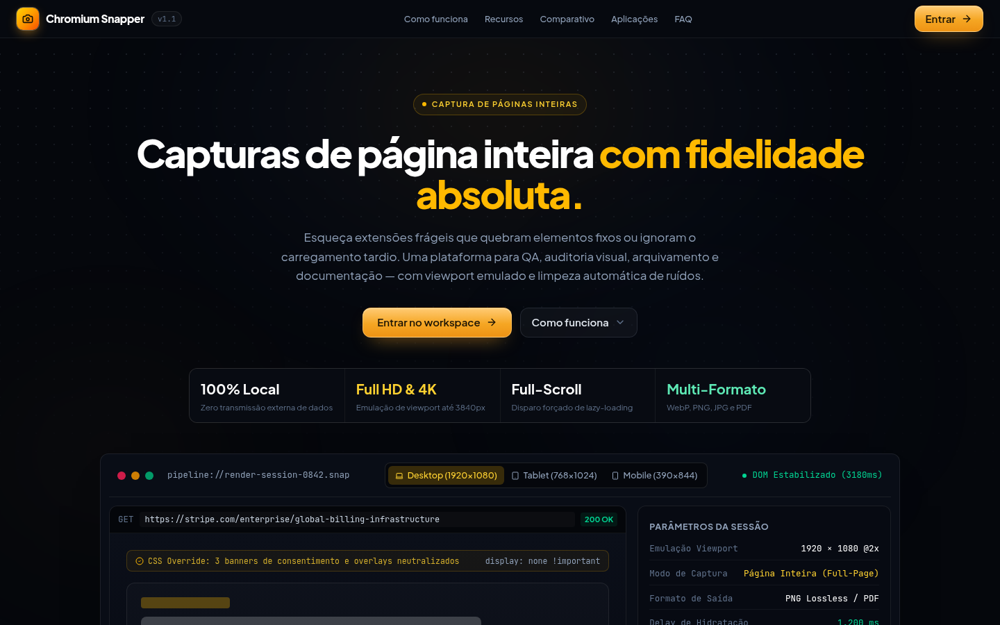
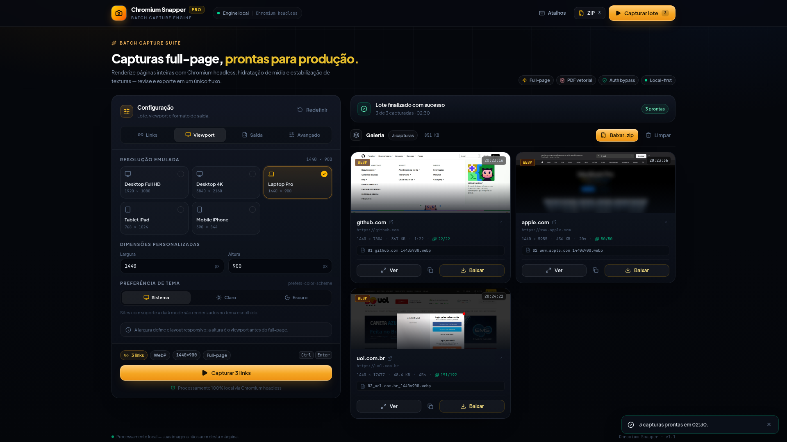
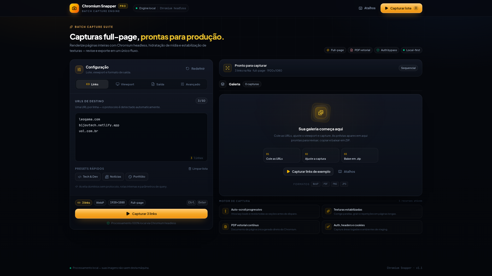
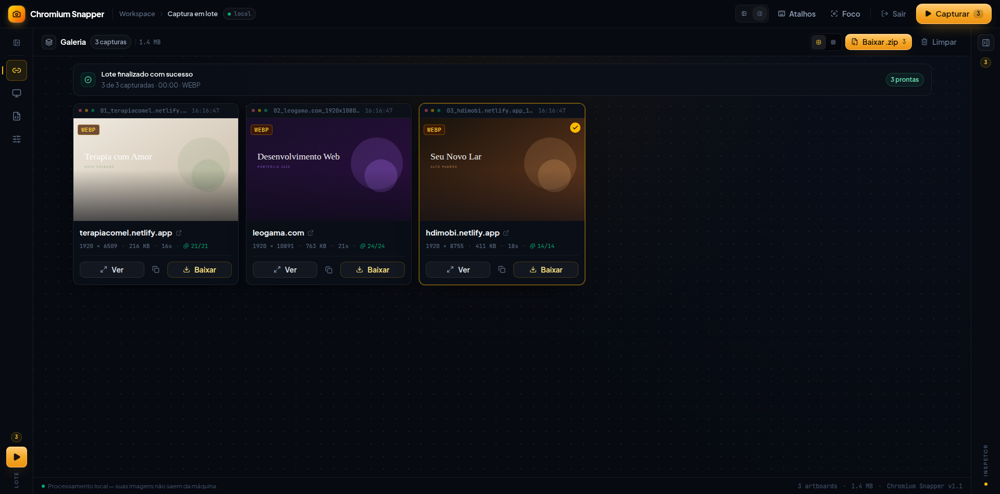
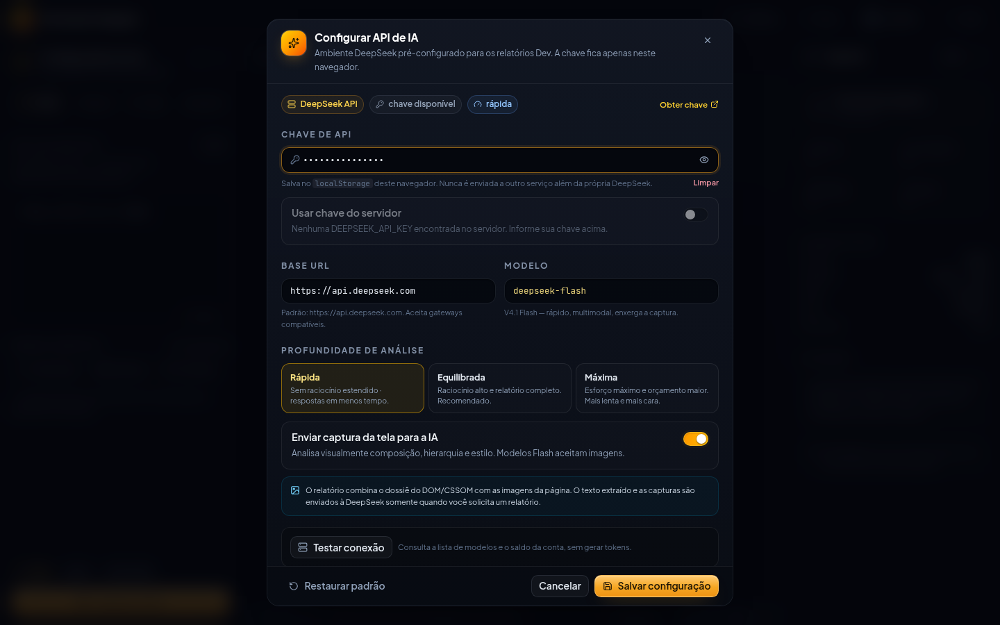
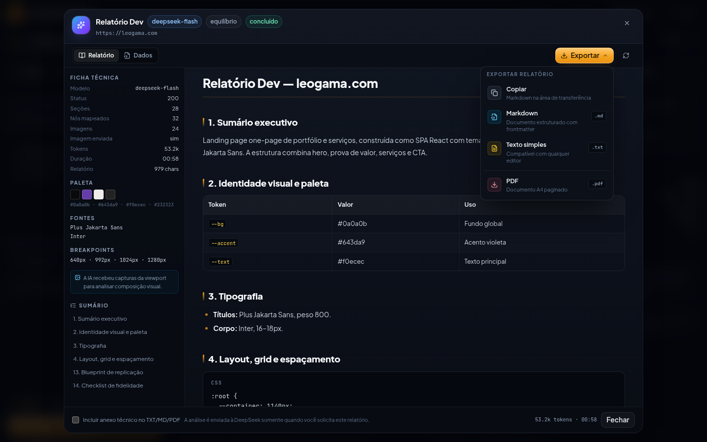

<div align="center">
  
</div>

<h1 align="center">Chromium Snapper</h1>

<p align="center">
  Landing page e workspace para captura <strong>full-page em lote</strong> com Chromium,<br />
  streaming em tempo real, prévia navegável e exportação em ZIP.
</p>

<p align="center">
  <a href="#recursos">Recursos</a> ·
  <a href="#começando">Começando</a> ·
  <a href="#como-funciona">Como funciona</a> ·
  <a href="#api">API</a> ·
  <a href="#atalhos">Atalhos</a>
</p>

---

## Recursos

- **Relatório Dev com IA (DeepSeek)**: cada captura bem-sucedida ganha a ação **Obter relatório Dev**. A IA recebe um dossiê extraído do navegador (DOM, CSSOM, tipografia, cores, grid, breakpoints, componentes, assets, stack e acessibilidade) e as imagens da viewport para produzir uma engenharia reversa completa, com blueprint de replicação, design tokens e checklist de fidelidade. O documento abre na aplicação em streaming e o menu **Exportar** oferece **Copiar**, **Markdown (.md)**, **TXT** e **PDF**.
- **Seção de usuário no header**: menu antes de "Sair" com status da IA, acesso à **Configuração da API de IA** (chave DeepSeek, Base URL, modelo e profundidade de análise) e ao histórico local de **Relatórios Dev**. A chave pode vir do navegador ou de `DEEPSEEK_API_KEY` no servidor.
- **Captura em lote** de até 50 URLs por execução, com progresso via Server-Sent Events, ETA e interrupção a qualquer momento.
- **Viewport configurável**: presets Full HD, 4K, laptop, tablet e mobile, além de largura/altura personalizadas e emulação de `prefers-color-scheme`.
- **Saída flexível**: WebP, PNG, JPG e PDF vetorial contínuo, com controle de compressão para formatos com perda.
- **Renderização inteligente**: scroll progressivo com suporte a altura dinâmica, hidratação de imagens lazy, desbloqueio de overflow, estabilização de texturas/parallax e redução de grain.
- **Captura limpa**: supressão de cookies, newsletters, chat widgets e modais de login que cobrem a hero. O CSS de lazy-load é cirúrgico e não revela overlays ocultos.
- **Acesso ao workspace**: landing page com CTA de entrada, retomada da sessão via `sessionStorage` e saída pelo header.
- **Autenticação**: headers HTTP e cookies de sessão para capturar áreas logadas e ambientes de staging.
- **Nomenclatura tokenizada** (`[ordem]`, `[url]`, `[data]`, `[hora]`, `[resolucao]`, `[formato]`) com prévia do nome em tempo real e **renomeação por captura antes do download**.
- **Canvas profissional**: artboards com prévia, inspetor de metadados, filtros por falha, densidade de grade, prévia com zoom, navegação por teclado, cópia para clipboard, download individual e ZIP gerado no servidor.
- **Workspace em canvas**: configuração em sidebar, área central de artboards, inspetor contextual persistente a partir de 1280 px (drawer abaixo disso), modo foco (`F`), drawer de configuração no mobile e fila visível com status por URL desde o início do lote.
- **Painéis retráteis**: configuração e inspetor recolhem para rails com atalhos contextuais; o estado é persistido, o recolher/expandir fica no cabeçalho de cada painel e o inspetor em telas menores é aberto pela toolbar do canvas.
- **Persistência local** de configurações e URLs, atalhos de teclado e acessibilidade (foco visível, focus trap, `aria-live` e `prefers-reduced-motion`).
- **Capturas 100% locais**: nenhuma imagem de captura sai da máquina. Somente quando o usuário solicita um **Relatório Dev** o dossiê técnico e as imagens da viewport são enviados à API DeepSeek configurada.

<div align="center">
  
  <sub>Canvas de capturas — artboards, inspetor de metadados e exportação em ZIP.</sub>
</div>

## Landing & acesso

A rota inicial apresenta a landing page da suíte. O botão **Entrar** libera o workspace, onde toda a interação de captura acontece; o botão de saída no header retorna à landing.

O acesso é um **gate visual local** (persistido em `sessionStorage`), sem autenticação de servidor. Para um ambiente com autenticação real, conecte seu provedor de identidade à transição de `landing` para `workspace` em [src/App.tsx](src/App.tsx).

<div align="center">
  
  <sub>Workspace em canvas: configuração à esquerda, área de artboards ampla e inspetor persistente a partir de 1280 px (drawer em telas menores).</sub>
</div>

<div align="center">
  
  <sub>Painéis retráteis: configuração e inspetor recolhem para rails com atalhos, ampliando o canvas.</sub>
</div>

## Stack

| Camada | Tecnologia |
| --- | --- |
| UI | React 19, TypeScript, Tailwind CSS 4, Lucide |
| Captura | Puppeteer + Chromium headless |
| Relatório Dev | API DeepSeek (chat completions com streaming e visão) |
| Servidor | Express 4 + Vite (middleware mode) |
| Empacotamento | JSZip (server-side, sob demanda) |
| Tipografia | Plus Jakarta Sans + JetBrains Mono (auto-hospedadas) |

## Começando

**Requisitos:** Node.js 20+ e npm 10+.

```bash
npm install
npm run dev
```

Acesse **http://localhost:3000**.

> O Puppeteer baixa o Chromium compatível durante o `npm install`. Se o binário não estiver disponível, rode `npx puppeteer browsers install chrome`.

Para usar outra porta:

```bash
PORT=3001 npm run dev
```

### Scripts

| Script | Descrição |
| --- | --- |
| `npm run dev` | Servidor de desenvolvimento com Vite HMR e watch do backend. |
| `npm start` | Sobe o servidor sem watch. |
| `npm run build` | Gera o bundle de produção em `dist/`. |
| `npm run start:prod` | Serve o build de produção na porta padrão (3000). |
| `npm run lint` | Verifica tipos com `tsc --noEmit`. |
| `npm run clean` | Remove `dist/` e artefatos de build. |

**Produção:**

```bash
npm run build
npm run start:prod
# http://localhost:3000
```

## Como funciona

1. A UI envia as URLs e as configurações para `POST /api/screenshot/stream`.
2. O servidor abre uma página headless por URL, aplica headers/cookies/tema, aguarda fontes e mídia da hero, remove overlays intrusivos e faz um scroll progressivo com re-medição de altura para disparar lazy loads — inclusive seções que só crescem após o primeiro scroll.
3. Cada captura é devolvida por SSE como `item_success` (metadados + thumbnail leve + URL do arquivo) ou `item_error`.
4. A galeria recebe apenas uma thumbnail leve por item. O arquivo completo fica no store do servidor e é buscado sob demanda para prévia, cópia ou download; o ZIP é montado no servidor a partir desses buffers.
5. O **Relatório Dev** abre a página novamente em Chromium, extrai um dossiê técnico estruturado, captura imagens da viewport e envia tudo para a API DeepSeek em streaming. O Markdown gerado é renderizado no diálogo e pode ser exportado em Markdown, TXT (no navegador) ou PDF A4 (renderizado no Chromium do servidor) pelo menu Exportar.

## Relatório Dev (IA)

<div align="center">
  
  
  <br />
  <sub>Configuração da API de IA e relatório Dev com ficha técnica, sumário e checklist.</sub>
</div>

1. No header do workspace, abra o menu **Usuário** e escolha **Configurar API de IA**.
2. O ambiente já vem apontando para `https://api.deepseek.com` e para o modelo `deepseek-flash`. Insira sua chave, ajuste o modelo/Base URL e escolha a profundidade de análise:
   - **Rápida**: sem raciocínio estendido, menor custo.
   - **Equilibrada**: raciocínio alto e relatório completo (recomendado).
   - **Máxima**: esforço máximo e orçamento maior.
3. Use **Testar conexão** para validar a chave, listar modelos e consultar o saldo da conta. O teste não gera tokens de resposta.
4. Capture uma página e clique em **Obter relatório Dev** no artboard, na prévia ou no inspetor. A geração mostra as fases (navegação, extração, análise, redação), permite acompanhar o raciocínio e mantém o relatório no histórico local.
5. No diálogo você pode abrir o relatório novamente e usar o menu **Exportar** para **Copiar**, baixar **Markdown (.md)**, **TXT** ou **PDF**. Os **dados técnicos em JSON** ficam na aba Dados, e o dossiê bruto pode ser anexado aos downloads.

**O que é enviado à DeepSeek:** o JSON com dados extraídos do DOM/CSSOM (título, metadados, seções, estilos computados, tipografia, paleta, componentes, assets, stack, acessibilidade e textos visíveis) e, quando o modelo aceita visão, até duas capturas da viewport. A chave fica em `localStorage` (ou em `DEEPSEEK_API_KEY` no servidor) e não é enviada a nenhum outro destino. Evite gerar relatórios de páginas com dados sensíveis.

**Modelos:** `deepseek-flash` aceita imagens e é o padrão; `deepseek-v4-pro` é voltado a raciocínio profundo em texto. O campo de modelo é editável para gateways compatíveis. Consulte a [documentação de visão da DeepSeek](https://api-docs.deepseek.com/guides/vision).

## Arquitetura

```text
.
├── server.ts                  # Express, SSE de captura, pipeline do Chromium, IA/relatório e PDF
├── index.html                 # Shell, metadados, fontes e favicon
├── src/
│   ├── App.tsx                # Roteamento landing/workspace, streaming SSE, ZIP, IA e persistência
│   ├── index.css              # Design tokens, superfícies, botões, foco e estilos do relatório
│   ├── lib/
│   │   ├── snapper.ts         # Tipos, presets, tokens de nomenclatura e utilidades
│   │   └── devReport.ts       # Tipos de IA, Markdown, exportação TXT/MD/PDF e template de impressão
│   ├── hooks/
│   │   ├── usePersistentState.ts
│   │   └── useFocusTrap.ts
│   └── components/
│       ├── LandingPage.tsx    # Landing inicial com CTAs de acesso
│       ├── TopBar.tsx
│       ├── UserMenu.tsx       # Seção de usuário: API de IA e histórico de relatórios
│       ├── AISettingsDialog.tsx # Chave DeepSeek, Base URL, modelo, profundidade e teste
│       ├── DevReportDialog.tsx  # Relatório em streaming, visualização e menu Exportar (MD/TXT/PDF)
│       ├── ReportsDialog.tsx    # Histórico local de relatórios
│       ├── ConfigPanel.tsx    # Abas Links / Viewport / Saída / Avançado
│       ├── ResultsPanel.tsx   # Status do lote, galeria, filtros e cards
│       ├── PreviewDialog.tsx  # Lightbox com zoom e navegação
│       ├── ShortcutsDialog.tsx
│       └── ui.tsx             # Switch, toasts, spinner e primitivos
└── docs/                      # Capturas usadas na documentação
```

## API

### `GET /api/health`

Retorna status, versão, engine, formatos e limite de URLs.

### `POST /api/screenshot/stream`

Content-Type: `application/json`. Responde com `text/event-stream`.

```json
{
  "urls": ["https://example.com", "https://example.org"],
  "format": "webp",
  "quality": 85,
  "width": 1920,
  "height": 1080,
  "fullPage": true,
  "enableAutoScroll": true,
  "heroWaitMs": 2000,
  "delayMs": 1200,
  "stabilizeTextures": true,
  "removeExcessGrain": false,
  "hideCookieBanners": true,
  "colorScheme": "no-preference",
  "namingPattern": "[ordem]_[url]_[resolucao]",
  "customHeaders": "Authorization: Bearer token",
  "customCookies": "session_id=abc123"
}
```

Eventos:

| Evento | Conteúdo |
| --- | --- |
| `start` | Total de URLs, formato e viewport. |
| `item_start` | Índice e URL em processamento. |
| `item_step` | Fase atual (`loading`, `hydrating`, `hero_settling`, `texture_stabilizing`, `scrolling`, `decoding`, `settling`, `capturing`). |
| `item_success` | Metadados, dimensões, duração, estatísticas de imagens, thumbnail e `fileUrl` do arquivo completo. |
| `item_error` | URL, mensagem de erro e duração. |
| `complete` | Fim do lote. |
| `fatal_error` | Falha que interrompeu o lote. |

### IA e Relatório Dev

- `GET /api/ai/status` — informa se existe `DEEPSEEK_API_KEY` no servidor, a Base URL e o modelo padrão.
- `POST /api/ai/test` — valida chave/Base URL, lista modelos e consulta saldo. Body: `{ apiKey?, baseUrl?, model? }`.
- `POST /api/dev-report/stream` — responde `text/event-stream` com `stage`, `meta` (dossiê extraído), `reasoning`, `delta`, `done` e `error`. Body:

```json
{
  "url": "https://example.com",
  "capture": {
    "width": 1920,
    "height": 1080,
    "autoScroll": true,
    "heroWaitMs": 2000,
    "delayMs": 800,
    "colorScheme": "no-preference",
    "hideCookieBanners": true,
    "customHeaders": "",
    "customCookies": ""
  },
  "ai": {
    "apiKey": "sk-...",
    "baseUrl": "https://api.deepseek.com",
    "model": "deepseek-flash",
    "depth": "balanced",
    "includeImage": true
  }
}
```

- `POST /api/dev-report/pdf` — recebe `{ markdown, title, url, model, createdAt, usage?, technical?, appendix? }` e devolve um PDF A4 renderizado no Chromium.

### Endpoints auxiliares

- `POST /api/screenshot` — recebe o mesmo payload e devolve um ZIP gerado no servidor (útil para automações).
- `GET /api/captures/:batchId/:itemId` — entrega o arquivo completo sob demanda (`?download=1&name=...` força download com nome customizado).
- `POST /api/captures/pack-zip` — monta o ZIP no servidor a partir de `{ files: [{ batchId, itemId, fileName }] }`, com nomes únicos.
- `POST /api/screenshot/pack-zip` — empacota itens `{ fileName, format, dataUrl }` já capturados (compatibilidade).

### Tokens de nomenclatura

| Token | Exemplo |
| --- | --- |
| `[ordem]` | `01` |
| `[url]` | `github_com` |
| `[data]` | `2026-11-05` |
| `[hora]` | `20-30-00` |
| `[resolucao]` | `1920x1080` (viewport solicitado) |
| `[formato]` | `webp`, `png`, `jpg`, `pdf` |

## Atalhos

| Atalho | Ação |
| --- | --- |
| `Ctrl` / `Cmd` + `Enter` | Iniciar captura do lote |
| `Esc` | Fechar prévia ou diálogo |
| `←` / `→` | Navegar entre capturas na prévia |
| `+` / `−` | Zoom na prévia |
| `0` | Ajustar imagem à tela |

## Limites e segurança

- Capturas são **sequenciais** para preservar memória e estabilidade do Chromium.
- Limite de **50 URLs** por lote; viewport entre 320 e 7680 px de largura (altura até 4320 px).
- Não há proteção SSRF: a ferramenta foi projetada para uso **local/confiável**. Não exponha o servidor publicamente.
- Headers e cookies ficam no `localStorage` do navegador. Use apenas em máquinas confiáveis.
- A chave da DeepSeek fica no `localStorage` (ou em variável de ambiente do servidor). O teste de conexão e a geração de relatórios passam pelo backend local, que nunca registra a chave em log.
- Relatórios Dev enviam dados extraídos da página e capturas da viewport para a DeepSeek. As capturas em si continuam locais; o envio ocorre apenas sob ação explícita do usuário.
- O servidor encerra o navegador ao final do lote e mantém as capturas em memória por até 30 minutos para prévia/download; depois elas expiram. O ZIP é gerado no servidor, sem reenviar imagens em base64 para o navegador.

---

<p align="center"><sub>Chromium Snapper · v1.2.0 · processamento local-first com relatórios Dev opcionais</sub></p>
